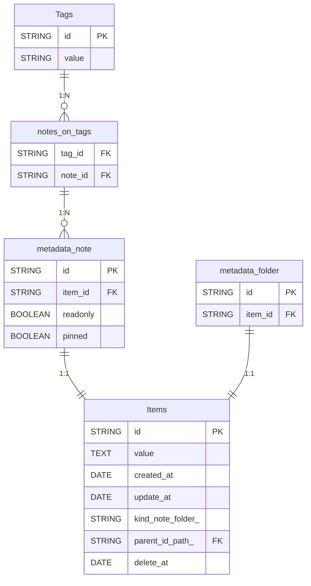

# Database schema: Notes

## Database schema

### Tags
- id STRING PK NOT NULL
- value STRING NOT NULL

### metadata_note
- id STRING PK NOT NULL
- item_id STRING FK NOT NULL
- readonly BOOLEAN NOT NULL
- pinned BOOLEAN NOT NULL

### Items
- id STRING PK NOT NULL
- value TEXT
- created_at DATE NOT NULL
- update_at DATE
- kind (note | folder) STRING NOT NULL
- parent_id (path) STRING FK
- delete_at DATE

### notes_on_tags
- tag_id STRING FK NOT NULL
- note_id STRING FK NOT NULL

### metadata_folder
- id STRING PK NOT NULL
- item_id STRING FK NOT NULL

## Relationships
- notes_on_tags 1:N metadata_note
- Tags 1:N notes_on_tags
- metadata_note 1:1 Items
- metadata_folder 1:1 Items

## ER diagram (Mermaid)

